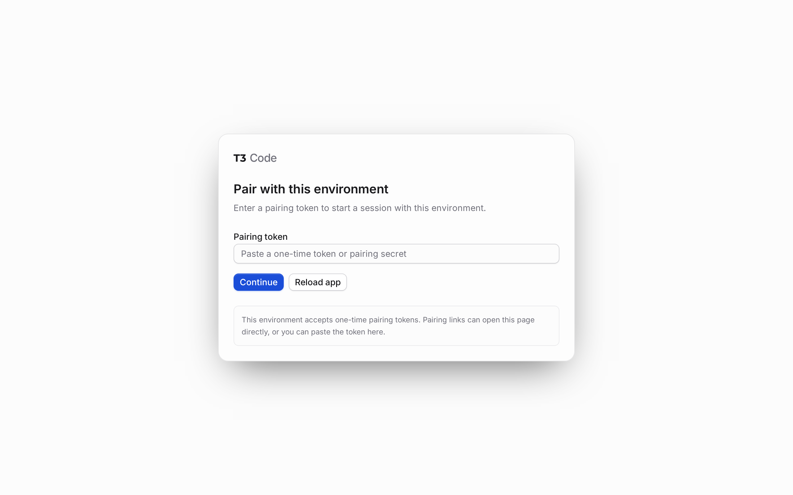

# T3 service validation

Validated on November 10, 2026, in the disposable `work-jatt-issue6-proof`
workspace. The live Work-Jatt workspace and its image configuration were not
changed. The disposable workspace was stopped after validation; its volumes
were preserved.

## Environment

- Bluefin/Dudley OS Dakota, Linux x86_64.
- Devsy v1.26.0, Docker provider v1.0.0.
- Docker Engine 29.9.3, rootless, systemd cgroup driver, cgroup v2.
- Image `ghcr.io/joshyorko/room-of-requirement@sha256:654fe3ba96249fb4812cf888e6179a43cc2f6c3c6b0ec1154b982645dc212fe3`.
- Unchanged `joshyorko/tools/t3code-cli-main` formula version
  `main.20261111003011.3a8c250cb0c8`.

The bare image does not include Python. This disposable test installed `python3`
with Homebrew instead of running Work-Jatt's unrelated bootstrap hooks. Normal
Work-Jatt bootstrap already installs Python. No temporary HOME or T3CODE_HOME
override, service drop-in, AI account authorization, or T3 Connect setup was used.

## Results

| Check | Result |
| --- | --- |
| Fresh task script run through Devsy exec | Installed the formula and started its real Homebrew user unit. |
| Readiness | `sh.brew.t3code-cli-main.service` was active as `vscode`, UID 1000. MainPID 3377 was the sole T3 server and owned TCP port 3773. |
| Repeated task and two separate SSH sessions as `vscode` | All passed with MainPID 3377 unchanged. The installed formula was neither upgraded nor restarted. |
| Devsy workspace stop/start | The enabled service started automatically as MainPID 181. A second stop/start after recreation verified MainPID 118 and its owned port 3773 directly, before rerunning the task. |
| Devsy workspace recreation | A marker in persisted `.t3` data survived while the formula keg disappeared. After restoring the bootstrap's Python prerequisite, rerunning the task installed the formula and verified MainPID 2155 and port 3773. |
| Missing user bus | With `XDG_RUNTIME_DIR=/tmp/issue6-no-user-bus`, the task failed with the #5 prerequisite before installing the absent T3 formula. |
| Legacy image | Running the task directly as `vscode` with Bash as PID 1 in the legacy `:wolfi` image failed before installation and linked to #5. Its tested digest was `sha256:a6d1190169eb85acb7ffb5be7460e8c43e4d8d5c8602bbc4c081868d733caff3`. |
| Known degraded system state | Failed units remained visible as a warning. Required managers, the user bus, and T3 worked. |
| Automated checks | All 57 Python tests and 9 extension tests passed on the host. All 17 focused T3 tests also passed inside the disposable systemd workspace. ShellCheck, Bash syntax, and whitespace checks passed. |

The focused tests also exercise a non-systemd PID 1, duplicate setup, competing
servers, the default-port conflict, the wrong formula process, and successful
start commands that never produce a listener. The procfs tests use real Linux
processes and sockets scoped to the test's own processes.

## Browser evidence

The real formula-served T3 application loaded over a temporary SSH forward from
host port 13773 to container port 3773. It presented its local pairing screen.
The service status and owned-listener checks above passed independently.



This proves that the application serves its browser UI. An authenticated UI or
terminal walkthrough and selecting the task in a real VS Code task picker were
not exercised. The task's manual process configuration is checked automatically.

## Repeat the checks

Run the offline checks from the repository root on the Linux host:

```sh
python3 -m unittest discover -s tests
node --test tests/headroom-vscode.test.js
shellcheck .vscode/install-t3-service.sh
bash -n .vscode/install-t3-service.sh
git diff --check
```

For a disposable runtime check, copy `.vscode/tasks.json`,
`.vscode/install-t3-service.sh`, and `.vscode/check-t3-service.py` into the same
relative paths in a new temporary workspace directory. On the Linux host, use
Devsy's Docker provider and the pinned test configuration:

```sh
devsy --provider docker workspace up /tmp/work-jatt-t3-proof \
    --id work-jatt-t3-proof \
    --devcontainer "$PWD/tests/fixtures/t3-systemd.devcontainer.json" \
    --ide-launch skip --ssh-configure=false --disable-daemon
```

After Devsy reports ready, complete the Python prerequisite in the disposable
container as `vscode`. Then run `/bin/bash .vscode/install-t3-service.sh` twice
inside that workspace. For SSH checks, pass `--user vscode` explicitly to
`devsy workspace ssh`. Inspect the service before rerunning the task after a
stop/start. Recreate only the disposable workspace, preserve its HOME volume,
and rerun the prerequisite and task to verify restoration.
